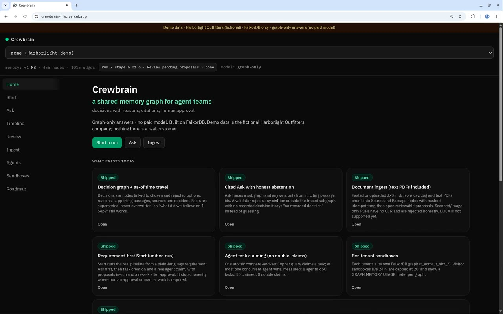

# Crewbrain

Crewbrain is a shared memory for teams that work with AI agents. Every decision the team makes is stored in one FalkorDB graph, together with the reasons behind it and the sources it came from. Anyone can ask why a decision was made and get an answer that can be checked.

Most agent memory tools return text that sounds right and cannot be verified. Crewbrain answers from the graph itself. Every answer shows the exact path through the graph and cites the nodes it used, and a validator rejects any citation that is not part of that path. When no decision was recorded, Crewbrain says so and stops. It does not invent an answer.

Facts in the graph are replaced, never erased. A decision that has been superseded stays in the graph with its history, and an ask can be run as of an earlier date to see what the team believed at that time.

New information enters the graph only through proposals. A document or chat log that is ingested becomes a proposal, and a person must approve or reject it before it becomes shared memory. Agents cannot approve their own proposals.

The agents board is where the crew coordinates work. An agent claims a task with one atomic compare and swap in the graph, so two agents can never hold the same task. A handoff between agents must carry evidence of the work done. In the race test that ships with the app, eight agents claim fifty tasks at the same time and the graph ends with zero double claims.

Every visitor can open a sandbox. A sandbox is a separate tenant graph that lives for 24 hours and stays away from the demo data, so the full flow can be tried safely.

Honest limits. Retrieval today is keyword and fuzzy matching, not semantic vector search. Agents claim tasks but do not execute the work itself. Isolation is one graph per tenant, and organisation level sandboxing is not built yet.

Watch the demo. It runs under two minutes and is narrated.

[Watch the demo video](demo/crewbrain-demo.mp4) · [Live demo](https://crewbrain-lilac.vercel.app)

Crewbrain was built for Graph Hacks, the FalkorDB hackathon, for the Agent Memory and Coordination track and the Company Brain track.
