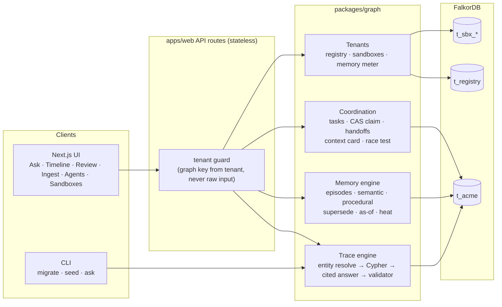
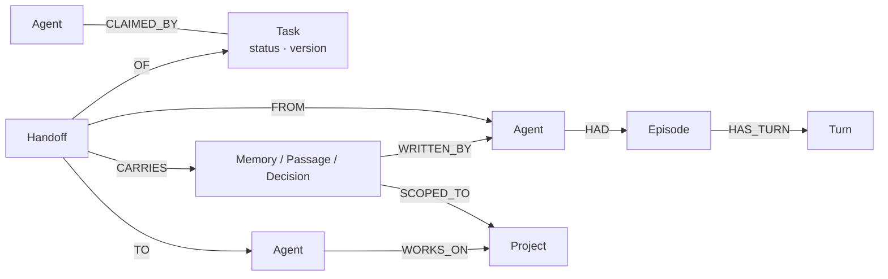

# Crewbrain

**A shared memory graph for a crew of AI agents and the people they work for. Every answer comes with the path through the graph that produced it.**

Built during [Graph Hacks: Context for AI Agents](https://www.wemakedevs.org/hackathons/falkordb) (15–18 Oct 2026), on FalkorDB.
Tracks: **Agent Memory and Coordination** (main) and **Company Brain**. License: MIT.

## Demo

**[Watch the demo video](demo/crewbrain-demo.mp4)** (93 seconds, narrated) · [Live demo](https://crewbrain-lilac.vercel.app)

The video walks through the live site on the Harborlight Outfitters demo data: a traced answer with citations, an abstention when nothing is recorded, an as-of ask, proposal review, the agents board, and visitor sandboxes.

## Why

Teams now run several AI agents: a researcher, a coder, a reviewer, an ingest bot. Each one forgets everything between sessions, none of them knows what the others decided, and when one says "we chose Amazon S3", nobody can tell where that came from.

The questions people ask about this are questions about connections: *why* (decision → reason → source), *who knows* (person → project → system), *what did the reviewer hand the coder* (agent → handoff → task → memory). In a graph each of those is one Cypher query. Crewbrain keeps all of it in FalkorDB.

## What it does

| Feature | Where |
|---|---|
| **Ask why, with a trace.** Decisions link to chosen/rejected options, reasons, supporting passages, sources and deciders. The answer cites node ids, a validator rejects any citation not in the retrieved subgraph, and with no recorded decision it says so instead of guessing. | Ask page, `pnpm ask` |
| **Memory that changes over time.** Episodic (agent sessions and turns), semantic (sourced facts) and procedural (reviewed how-tos) memory. Facts are superseded, never overwritten, so "what did we believe on 1 Sep?" still works. | Timeline, Review, Ingest |
| **Shared tasks with an atomic claim.** One Cypher query compares the task version and claims it; at most one concurrent agent wins. | Agents page |
| **Handoffs that must carry evidence.** A handoff without at least one existing Memory, Passage or Decision is rejected. The receiver's next session starts from a context card built from the graph. | Agents page |
| **Race test.** 8 agents claim 50 tasks at once; the graph is then checked for double claims. | Agents page, tests |
| **One graph per tenant.** `t_acme`, plus visitor sandboxes `t_sbx_<8>` (24 h lifetime, cap 20). A `GRAPH.MEMORY USAGE` meter shows each graph's size. | Sandboxes page |

No paid AI: answers are built from the graph path ("graph-only mode"). An optional free-tier model can be added later; the product never fakes a model answer.

## Architecture



Every repository function takes a `TenantGraph` bound to exactly one graph key, so no query can reach another tenant's graph.

### Agent coordination model



The claim is a single query:

```cypher
MATCH (t:Task {id: $id}), (a:Agent {id: $agent})
WHERE t.version = $v AND (t.status = 'todo' OR (t.status = 'handed_off' AND t.assigned_to = $agent))
SET t.status = 'claimed', t.claimed_by = $agent, t.version = t.version + 1
MERGE (t)-[:CLAIMED_BY]->(a)
RETURN t
```

Zero rows back means another agent won. FalkorDB executes each write query atomically on a graph, so this is a compare-and-set.

**Scenario "Add signed URLs for lookbook videos"** (Agents page → Run scenario): `researcher` claims the task, writes two sourced memories and hands off to `coder`. `coder` starts a fresh session; its context card already lists the handoff and the researcher's memories. `coder` hands to `reviewer`, which flags a missing link expiry (citing the researcher's memory) and hands back. `coder` finishes. Every step is nodes and edges in the graph; nothing passes between agents in process memory.

### Concurrency (measured locally)

Race test, 8 agents × 50 tasks against a local FalkorDB, one shared client connection: **50 claimed, 0 double claims**, ~80–95 lost races (expected: agents retry), claim latency p50 ≈ 2.4 ms, p95 ≈ 3.6 ms. Numbers on FalkorDB Cloud will differ; the Agents page shows the live run.

## How to run

Requirements: Node 22+, pnpm, FalkorDB.

```bash
docker compose up -d falkordb          # FalkorDB on :6379, Browser on :3000
pnpm install
cp .env.example .env                    # FALKORDB_URL, defaults to redis://localhost:6379
pnpm migrate && pnpm seed               # schema + Harborlight demo graph (add --reset to wipe)
pnpm ask "Why did we choose Amazon S3 over MySQL for media storage?"
pnpm test                               # vitest against a real FalkorDB (throwaway graph keys)
pnpm dev                                # UI on http://localhost:8080
```

### Demo path

1. **Ask** "Why did we choose Amazon S3 over MySQL for media storage?" → answer, path list, the Cypher that ran. Ask "Why did we choose MongoDB?" → honest "no recorded decision".
2. **Ingest** the signed-URL sample chat → a proposal that partly supersedes the S3 decision. **Review** → approve as Nia.
3. **Ask** again with *as of* 1 Sep → old answer; now → new answer. **Timeline** shows the change.
4. **Agents** → Run scenario, then Race test.
5. **Sandboxes** → New sandbox; the Amazon S3 question has no answer there (different company).

## Deploy (Vercel + FalkorDB Cloud)

- Vercel project with **Root Directory `apps/web`** (config in `apps/web/vercel.json`).
- Set `FALKORDB_URL` in the Vercel environment (`rediss://…` for TLS). It is read only from the environment.
- Seed once from a laptop: `FALKORDB_URL=… pnpm migrate && FALKORDB_URL=… pnpm seed`.

## Layout

| Path | What |
|---|---|
| `apps/web` | Next.js App Router UI and API routes |
| `packages/graph` | FalkorDB client, `TenantGraph`, migrations, trace, memory, coordination, sandboxes |
| `seed/` | Fictional Harborlight corpus (40 sources), structured decisions, demo signed-URL chat |
| `scripts/` | `migrate`, `seed`, `ask` |
| `tests/` | vitest suites against a real FalkorDB |
